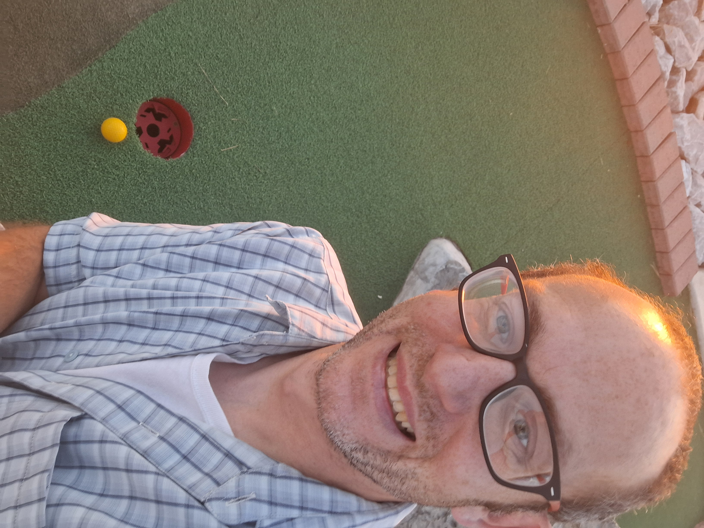

<section class="intro">
    <section class="page_hero">
        <h1>About Me</h1>
    </section>
    <section class="feature">
    

       
      

          

    <h2>Introduction</h2>
        
Partially disabled U.S. Air Force veteran of 16 years. I am a fast learner who enjoys seeing projects come together. I am a Christian, Husband, and Father. I grew up North of Seattle, Washington. I've lived in all four time zones in the continental USA as well as in South Korea, Guam, and had military tours in Kuwait and Qatar. I created this page both as a project and to be able to share with future potential employers.
 
          

        

    <h2>Interests and Hobbies</h2>
        
I enjoy drawing (both art and technical/plans), building (my family and I have been building our own home and workshop), and reading (primarily fantasy and sci-fy).

        

   

        

            
        

    </section>
</section>
<section class="interests">
    
</section>
<!--
<section class="experience">
    <ul class="experience__list">
        <li>
            Agency
            <time datetime="2026">2026</time>
        </li>
        <li>
            Agency
            <time datetime="2025">2025</time>
        </li>

        
    </ul>
        
</section>
-->
